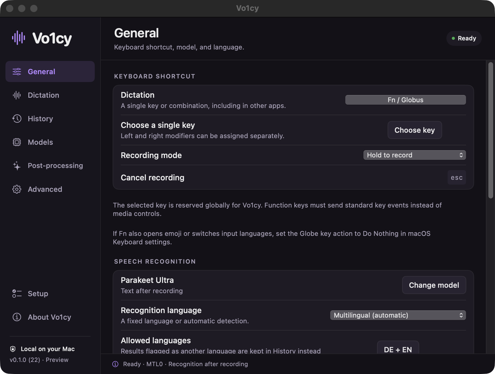

# Vo1cy

[](https://github.com/an0ymOnTelegram/Vo1cy/actions/workflows/build.yml)

Local speech-to-text for Apple Silicon Macs, powered by Parakeet Ultra. Hold a shortcut, speak, and insert the result into the app you are using.



**Preview release · macOS 14 or later · Apple Silicon only.** The interface is English. Recognize 25 languages, including English and German. Intel builds are not provided or validated.

[Download the Mac preview](https://github.com/an0ymOnTelegram/Vo1cy/releases) · [Setup](docs/SETUP.md) · [Parakeet Ultra](docs/MODELS.md) · [Privacy](docs/PRIVACY.md)

[Creator on Telegram](https://t.me/an0ym) · [Telegram community](https://t.me/jailbreakall)

## Install

1. Download the `arm64.dmg` from a GitHub release and open it.
2. Drag **Vo1cy** into **Applications**, then eject the disk image.
3. Launch Vo1cy from Applications and follow Setup: allow microphone access, download Parakeet Ultra. Files are verified before installation.
4. Enable Accessibility for automatic text insertion or standalone modifier shortcuts. Choose your shortcut and finish setup.

The first preview is ad-hoc signed, **not Developer-ID signed or notarized by Apple**. macOS may block the first launch. If you choose to trust this release, follow Apple's [Privacy & Security → Open Anyway instructions](https://support.apple.com/102445). No system-wide security setting needs to be disabled. You can also build from source.

## Features

- Local inference with Metal; no account, API key, or transcription subscription.
- Hold-to-record and toggle shortcuts, including individual modifier keys where macOS permits them.
- A microphone-level bubble with six screen positions.
- Configurable output muting, recording sound, volume, and local sound import.
- One verified Parakeet Ultra download, with model information, license links, and performance guidance.
- Multilingual recognition and an optional allowed-language check. The spoken language is preserved.
- Optional punctuation, sentence, filler, restart, and spoken-list rules for English and German.
- An empty-by-default custom dictionary, history corrections, whole-dictation rules, and literal protection.
- Configurable history retention, optional audio storage, audio-file transcription, and diagnostic export.
- One GUI instance and one main window per user. Opening the app again brings the existing instance forward.

Recognition and punctuation are imperfect, especially for very short words or mixed-language speech. The language check uses available language tags and writing systems; it does not strictly constrain the decoder. Flagged results stay in History instead of being pasted automatically. Text corrections are local rules, not model training.

## Speech recognition

**Parakeet Ultra** is the only supported speech-recognition model. It runs locally with Metal acceleration and produces text after recording stops. Choose automatic language detection or a fixed language. See [model details](docs/MODELS.md).

Keeping the model in memory reduces startup delay; keeping the microphone active further reduces delay and leaves the macOS microphone indicator visible. Both are configurable. Audio outside an active recording is discarded.

## Build

Install Xcode with Swift 6.2 or later, its command-line tools, CMake, and Git. On Apple Silicon:

```sh
git clone https://github.com/an0ymOnTelegram/Vo1cy.git
cd Vo1cy
./scripts/build-app.sh
```

This fetches the pinned native runtime, Swift dependencies, and bundled voice-activity model, then creates `dist/Vo1cy.app`. Parakeet Ultra is downloaded from inside the app. For repeated local development installs, `./scripts/install-local.sh` preserves a local signing identity and installs one current copy in Applications. Never distribute that local development archive.

Run `swift test` after bootstrapping the runtime with full Xcode selected, or run the standalone checks in [CONTRIBUTING.md](CONTRIBUTING.md). Build and release procedures are in [docs/RELEASING.md](docs/RELEASING.md).

## Updates and license

Preview updates are downloaded manually from GitHub Releases. The app's **View releases** action opens that page. A Sparkle update path is implemented but automatic installation is disabled until a signed, notarized release channel is configured. Model information updates with app releases.

Vo1cy's own source is [MIT licensed](LICENSE). It is free to use, modify, and redistribute under that license. Dependencies and model weights have separate terms; see [THIRD_PARTY_NOTICES.md](THIRD_PARTY_NOTICES.md). Vo1cy is inspired by Handy and uses transcribe.cpp; it is not an official Handy release.
